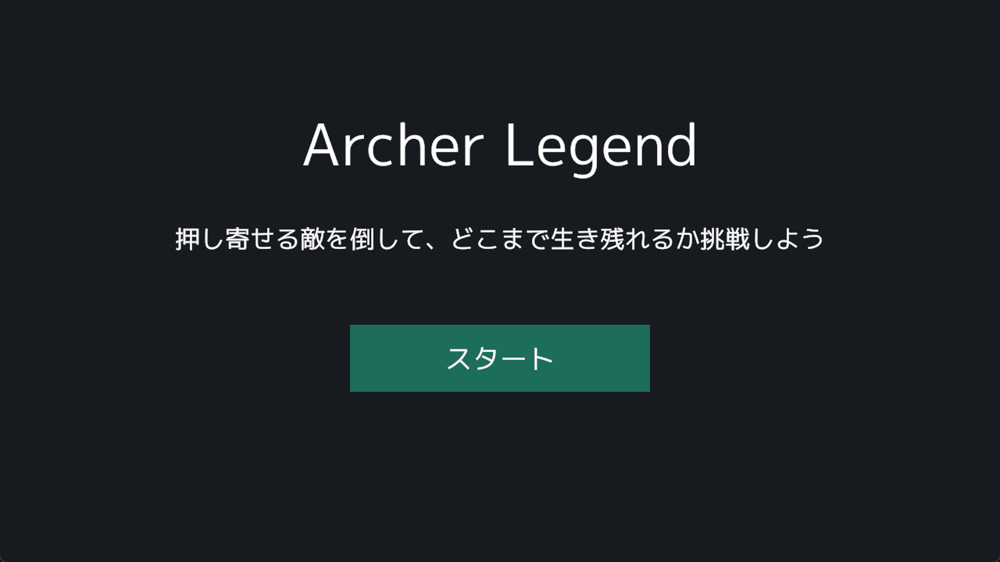
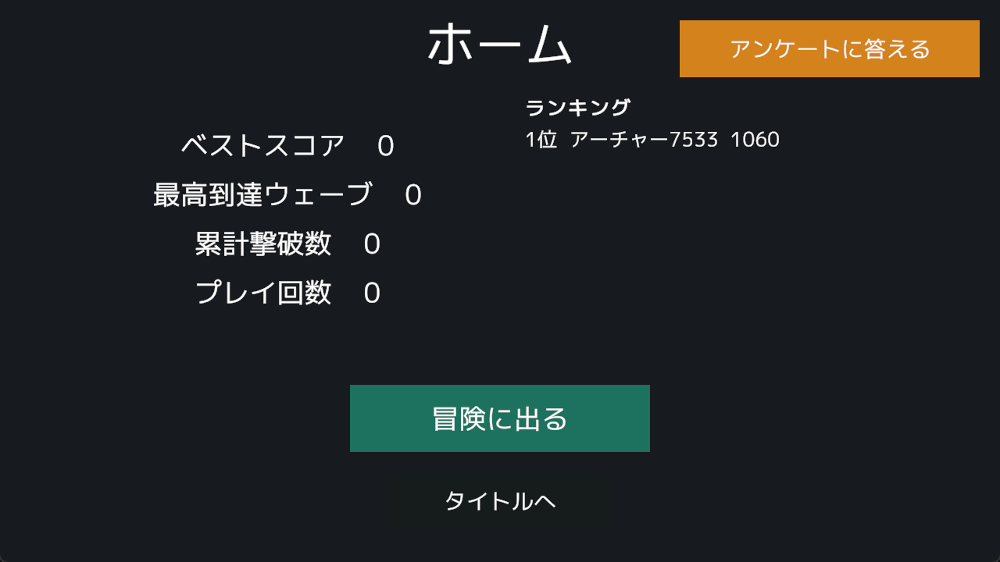
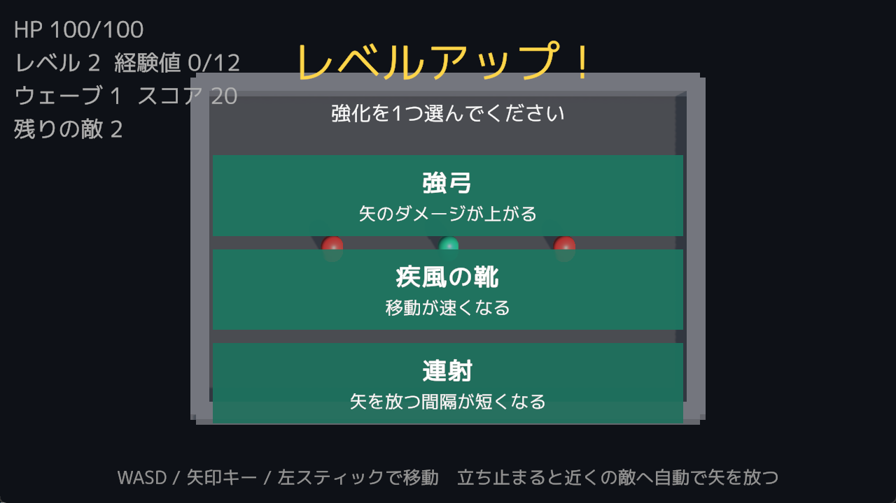

# ArcherLegend

見下ろし視点のウェーブ制アクションゲームと、そのゲームサーバー・運営ツールです。

**[Windows 版をダウンロード](https://github.com/rhymeeeen0812/archer-legend/releases/latest)**（zip を展開して `ArcherLegend.exe` を起動）

**[プレイ動画を見る（YouTube）](https://youtu.be/quTUp3GY71c)**

| タイトル | ホーム | レベルアップ |
|---|---|---|
|  |  |  |

## 制作について

- **制作期間**：2 日
- **担当範囲**：企画・ゲーム実装・サーバー・運営ツールのすべて（個人制作）
- **生成 AI の利用**：コードレビューと不具合の修正に Claude Code を利用しました

## 機能

- **ゲーム**：移動と自動攻撃、ウェーブ制の敵、レベルアップ時の強化選択、戦績の保存
- **オンライン**：プレイヤー登録、プレイ結果の送信、スコアランキング
- **アンケート**：運営ツールで作成・公開し、ゲーム内で回答、集計結果の確認と CSV 出力

## 工夫した点

- **オフラインでも遊べる**：プレイ結果はセーブデータに残し、接続できたときにまとめて送る。`runId` で再送しても二重に記録しない
- **同時更新で戦績が消えない**：PostgreSQL の `xmin` による楽観的同時実行制御を使う
- **層を分けてテストしやすくする**：ゲームのルールを Domain / Application 層に置き、Unity の画面は Presenter と View に分ける
- **実環境に近いテスト**：サーバーのテストは Testcontainers で本物の PostgreSQL を使う。Unity は EditMode テストで Presenter とプレハブの参照を確かめる
- **運営ツールの保護**：ログイン必須を既定にし、ゲーム用 API など必要なものだけを公開する

設計の詳細は [`server/README.md`](server/README.md) にまとめています。

## 今後の課題

- プレイヤー ID の漏えい対策とスコアの改ざん対策
- アンケートの説明文が長いときのスクロール表示
- 敵の種類やボス戦などのゲーム内容の追加

| フォルダ | 内容 | 技術 |
|---|---|---|
| [`client/`](client/) | ゲーム本体 | Unity 6 (6000.0.37f1) / URP |
| [`server/`](server/) | ゲーム用 API・運営ツール（アンケート作成と集計） | ASP.NET Core (.NET 10) / Blazor / PostgreSQL |

## 構成

```
[Unity クライアント] ──HTTP──> [ASP.NET Core サーバー] ──> [PostgreSQL]
                                    └─ 運営ツール (Blazor)
```

ログインは行わず、ゲームが初回起動時に作ったプレイヤー ID で識別します。

## 起動方法

1. サーバーを起動する（[`server/README.md`](server/README.md) を参照）
2. Unity Hub で `client/` を開き、`TitleScene` から再生する

接続先は `client/Assets/Resources/GameServerSettings.asset` で変更できます（既定は `http://localhost:5032`）。
サーバーが起動していなくてもゲームは遊べます。プレイ結果はセーブデータに残し、次に接続できたときにまとめて送ります。
